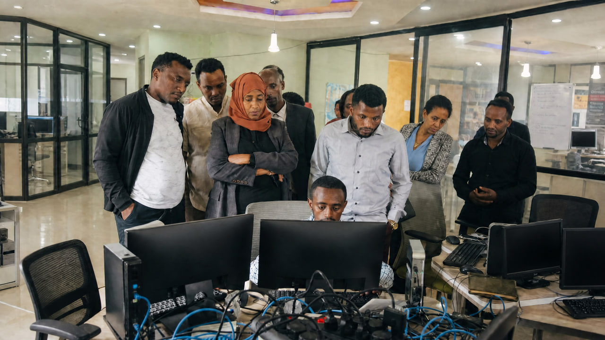

<div align="center">

# 🧬 TADIYOS ASCHALEW 
### ታዲዮስ አስቻለው
**Software & AI Engineer · Ethco Coder · Founder**


---

> ***"𝐼 𝑑𝑜𝑛'𝑡 𝑏𝑢𝑖𝑙𝑑 𝑜𝑛 𝑤ℎ𝑎𝑡'𝑠 𝑎𝑙𝑟𝑒𝑎𝑑𝑦 𝑎𝑠𝑠𝑢𝑚𝑒𝑑. 𝐼 𝑟𝑒𝑡𝑢𝑟𝑛 𝑡𝑜 𝑤ℎ𝑒𝑟𝑒 𝑡ℎ𝑒 𝑎𝑠𝑠𝑢𝑚𝑝𝑡𝑖𝑜𝑛𝑠 𝑏𝑒𝑔𝑎𝑛—𝑎𝑛𝑑 𝑟𝑒𝑏𝑢𝑖𝑙𝑑 𝑓𝑟𝑜𝑚 𝑡ℎ𝑒𝑟𝑒."***

</div>

---

## 🎯 Executive Vision

I'm a 20 y/o self-taught engineer from **Ethiopia** building the next generation of intelligent systems from first principles. No institution handed me this path. What drives every line of code here is a single conviction: **the foundations most people accept as fixed can, in fact, be rebuilt**.

Current AI hits hard ceilings—transformers scale quadratically, models forget what they learn, systems correlate but don't reason about causation. These aren't engineering problems. They're *architectural problems* requiring rethinking from the ground up.

That's what I do. I find the broken foundation. Understand why it broke. Rebuild it properly.

---

## 🛍️ Flagship Innovations

### 🌟 [Walia — The Sovereign Programming Language](https://github.com/nexuss0781/Walia)

- **Purpose:** A fifth-generation programming language built around persistent, stateful computation.
- **Core capabilities:**
  - Orthogonal persistence keeps variables available across restarts, power failures, and reboots without explicit serialization.
  - Register-based virtual machine with NaN-boxing.
  - Neural-native vectors as first-class values.
  - Dimensional typing that enforces physical relationships at compile time.

```walia
var session_count = 0;  // Persists automatically
session_count = session_count + 1;
print "Session #" + session_count;  // Survives across restarts
```

### 🧠 [Nexuss Neural Cognition — 270K Neurons in 500MB](https://github.com/nexuss0781/Nexuss-Neural-Cognition)

- **Purpose:** A biologically plausible spiking-neural-network simulator designed for large cognitive models within a fixed memory budget.
- **Scale:** 270,336 neurons and 13,516,800 synapses within 500 MB of RAM.
- **Architecture:** Universal Intellectual Neuron (UIN) building blocks with six neuron classes and five synapse types.
- **Performance:** O(1) update kernel reported at 94× real-time speedup, with a meta-cognitive controller for adaptive resource allocation.

### 🖼️ [Image-text — Atomic Logic Vision System (ALVS)](https://github.com/nexuss0781/Image-text)

- **Purpose:** A hybrid C++/Python image-processing engine that converts visual data into mathematical logic atoms.
- **Representation:** RGB matrix, Energy (luminance), and Flow (gradient) layers.
- **Performance:** Sub-200 ms processing for 8K UHD images, reported throughput of 508 MB/s, and lossless reconstruction with PSNR above 66 dB.

### 🤖 [Ardi-Agents — Sixteen Specialist AI Council](https://github.com/nexuss0781/Ardi-Agents)

- **Purpose:** An autonomous multi-agent orchestration engine for complex, end-to-end workflows.
- **Specialists:** Sixteen domain-focused agents covering language, analysis, innovation, frontend and backend development, debugging, QA planning, code quality, security, performance, UX, adversarial testing, and documentation.
- **Coordination:** Meta-cognitive planning connects specialist outputs into a collaborative development process.

### 🌐 [Nexuss Transformer Framework — Blank Slate to Superintelligence](https://github.com/nexuss0781/Nexuss-Transformer)

- **Purpose:** A production-oriented framework for training decoder-only large language models from scratch.
- **Model components:** RoPE embeddings, RMSNorm, SwiGLU, and Multi-Query Attention.
- **Training lifecycle:** Pre-training, LoRA fine-tuning, and RLHF alignment through PPO/DPO.
- **Language support:** Integrates EthioBBPE for Amharic and Ge'ez tokenization.

### 🥏 [Attention Kernel — Metric-Aware Geometry](https://github.com/nexuss0781/Attention)

- **Purpose:** A C++20 numerical kernel for metric-aware attention geometry.
- **Operations:** Builds learned positive-definite metrics, computes symmetric whitening operators, and transforms query/key coordinates.
- **Design targets:** Deterministic F32 CPU tensors and context lengths up to one million tokens.
- **Validation:** Forward-path checks include numerical guards and condition-number bounds.

### 🛸 [CDI — Compact Causal Language Engine](https://github.com/nexuss0781/CDI)

- **Purpose:** An evidence-gated research implementation of selective cohomodynamic recurrent state-space models for causal language processing.
- **Current implementation:** CDI v3 uses the EthioBBPE tokenizer, sparse graph-Laplacian correction, and tied output projection.
- **Reported results:** CCT-G3.4 showed a 21% throughput improvement from token-residual evidence; CCT-G3.6 achieved bounded continuation at 6.576891 validation loss and outperformed GRU baselines across all seeds.
- **Verification:** 297 tests pass, with geometry re-confirmed through the G3.1–G3.6 gates.

---

## 🛠️ Technical Mastery

| Domain | Technologies | Impact |
|--------|-------------|--------|
| **AI/ML** | Spiking networks, spectral attention, continual learning, RLHF | O(n) attention, 270K neuron self-optimizing networks |
| **Languages** | Register VMs, orthogonal persistence, dimensional typing | Walia: variables survive restarts by default |
| **Quantum** | Native primitives on classical hardware (ASC, RPW, NCB) | GHZ states, Bell verification on laptops |
| **Distributed Systems** | Circuit breakers, zero-copy I/O, exponential backoff | 2,050% throughput improvement in FTP |
| **NLP** | BPE for Ethiopian scripts, blank-slate training | Amharic, Ge'ez, biblical text processing |
| **Signal Processing** | STFT, SIMD optimization, lossless conversion | 245× audio processing speedup |
| **Full-Stack** | React, TypeScript, Flask, FastAPI, TailwindCSS | 9-role school management, 140+ API routes |

---

## 🤝 Let's Build

I work where current approaches plateau. If you care about:
- 🎯 Rebuilding AI foundations instead of scaling broken assumptions
- ✓ Mathematical proofs over empirical approximations
- 🌍 Technology serving underserved language communities
- 🚀 Production systems that actually ship
- ⚛️ Quantum-classical computing on available hardware
- 🧠 Cognitive architectures that accumulate knowledge

Let's talk.

**📧 nexuss0781@gmail.com**

---

<div align="center">



*Self-taught. Community-rooted. Foundation-first.*

**Find the broken foundation. Understand why it broke. Rebuild it properly.**

---

### 🌟 Connect
- [Email](mailto:nexuss0781@gmail.com)
- [Portfolio](https://nexuss.pro.et/)
- [Hugging Face](https://huggingface.co/Nexuss0781)
- [Telegram](https://t.me/Nexuss_stuff)
- [LinkedIn](https://www.linkedin.com/in/nexuss0781/)
- [PyPI](https://pypi.org/project/EthioBBPE/)
---

## GitHub Stats

<div align="center">
  
  
</div>
